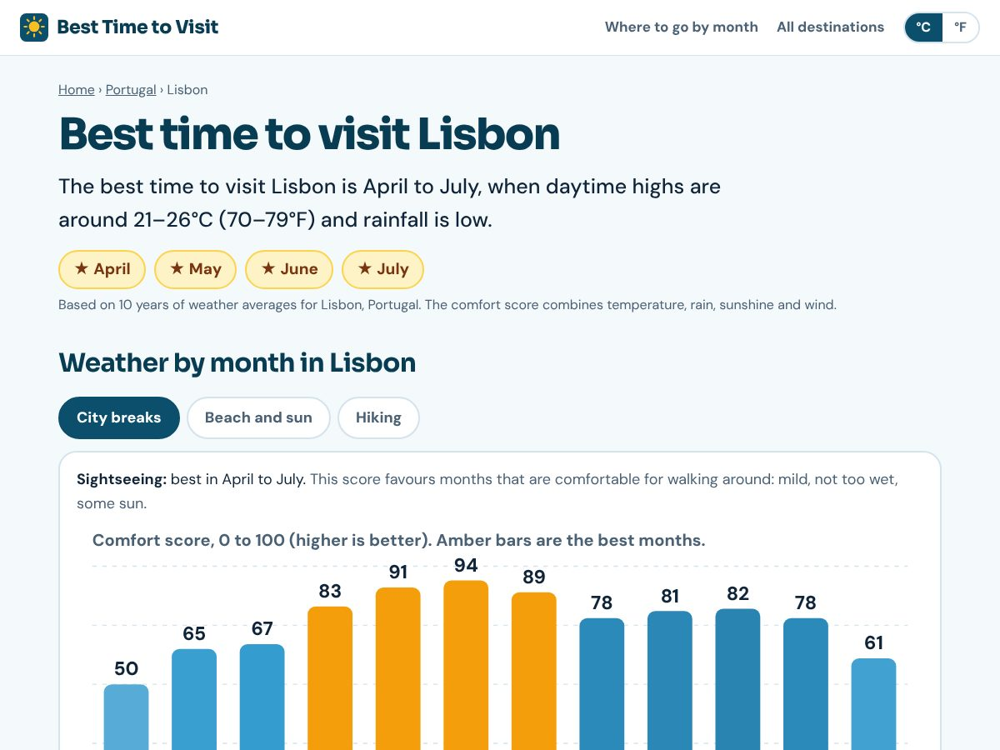
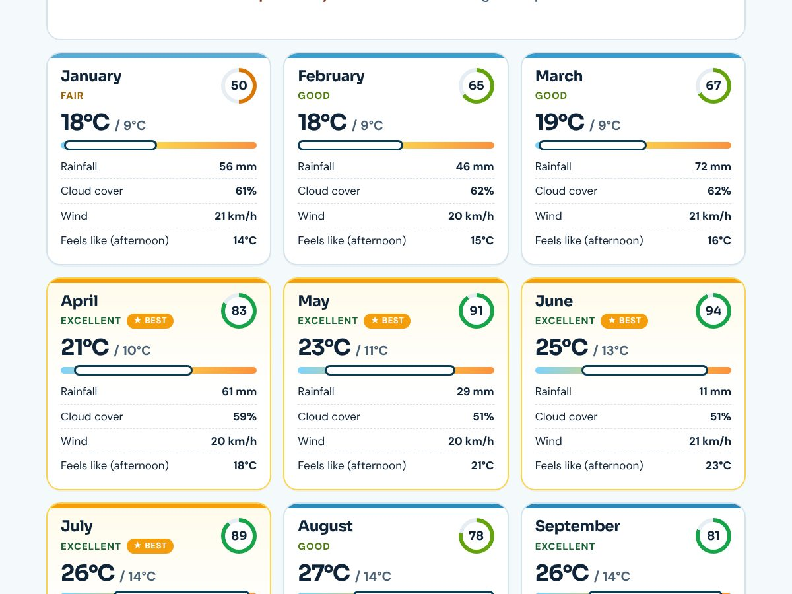

<div align="center">

# ☀️ Best Time to Visit

**When is the best time to visit? Weather by month for 700 cities and travel destinations, one page for each.**

[](https://best-time-to-visit.vercel.app)
[](https://nuxt.com)
[](https://power.larc.nasa.gov/)
[](#-privacy-and-analytics)

[**Open the site →**](https://best-time-to-visit.vercel.app)



</div>

## ✨ What it does

Pick a place and see which months give you the best weather.

- **A page for every destination.** About 700 big cities and travel spots, from Tokyo and Paris to Santorini, Bali and Chamonix. Each page has the best months, a 12-month chart, a card for every month and an FAQ.
- **Trip types.** Switch between sightseeing, sun and beach weather, hiking and (for ski resorts) skiing. The best months change with it.
- **A comfort score** from 0 to 100 per month, built from the afternoon "feels like" temperature, rainfall, cloud cover and wind.
- **Where to go in a month.** Twelve pages ranking destinations by how good the weather is in March, July and so on.
- **Country pages** that list every destination in a country with its best months.
- **°C and °F, mm and inches, km/h and mph**, remembered per browser.
- **Fast and static.** Every page is pre-rendered, so it loads instantly and works for search engines. Each page has its own title, description, canonical link, FAQ and breadcrumb structured data, and the site has a sitemap.

<div align="center">

</div>

## 🧠 How the score works

For each month and trip type:

| Part | How it is used |
| --- | --- |
| Feels-like temperature | The afternoon high, adjusted for humidity and wind, compared with a comfortable range for the trip type |
| Rainfall | Monthly rainfall against a "too wet" limit for the trip type |
| Sunshine | Cloud cover, so a clear month beats a grey one |
| Wind | A small penalty above about 25 km/h |

A month that is too hot or too cold cannot be rescued by dry, sunny weather, so temperature also scales the total. The best months are the ones within 12 points of the top score. Skiing uses a separate rule based on cold and precipitation. The logic is in [`shared/utils/climate.js`](shared/utils/climate.js) and is covered by tests.

## 🌍 Where the data comes from

[NASA POWER](https://power.larc.nasa.gov/) monthly averages for the last 10 full years, one light request per destination. Free, no API key.

Gridded data has limits, and the site says so:

- The grid cells are about 50 km wide, so mountains and coasts can differ from the number.
- POWER's own daily high and low values are not averages (they are extremes), so highs and lows are rebuilt as the monthly mean plus or minus half the typical daily range. The range comes from sunshine using the Hargreaves-Samani relation. Spot checks for Paris, London, Prague, Bangkok and Dubai landed within about 2 to 3 °C of published normals.
- The score is about **weather only**. It knows nothing about crowds, prices, events or school holidays.

## 🏗️ How it is built

```
data/cities.json       destinations (GeoNames big cities + hand-picked travel spots)
scripts/fetch-climate  downloads the climate data at build time into data/climate.json
server/api/*           small routes that read that data while pages are pre-rendered
app/pages/*            home, destination, country and month pages (Nuxt, static output)
shared/utils/climate   scoring and text logic, shared by the build, the pages and the tests
```

`npm run build` fetches the climate data (about 700 requests, a few minutes the first time, cached afterwards) and then runs `nuxt generate`. If too much data is missing the build stops instead of publishing an empty site.

## 🛠️ Run it yourself

```bash
npm install
npm test                       # unit tests for the scoring logic
MOCK_CLIMATE=1 npm run climate # fake data, only for trying the site offline
npm run dev                    # http://localhost:3000
npm run build                  # real data + static site in .output/public
```

To add a destination, add it to `scripts/build-cities.mjs` (the `EXTRA` list) and regenerate `data/cities.json`.

## 🔒 Privacy and analytics

No accounts, no cookies, no database, no server of our own. The only thing stored in your browser is your °C/°F choice.

The hosted site uses [Vercel Web Analytics](https://vercel.com/docs/analytics) to count anonymous page views. It does not use cookies or track individuals. If you run your own copy, remove the two analytics lines in `app/app.vue`.

## ⚖️ Notes

Weather data: NASA POWER. Fonts: Sora and DM Sans (SIL Open Font License), hosted with the site. Use the weather as a guide, not a guarantee, and check the forecast, local events and prices before you book.
